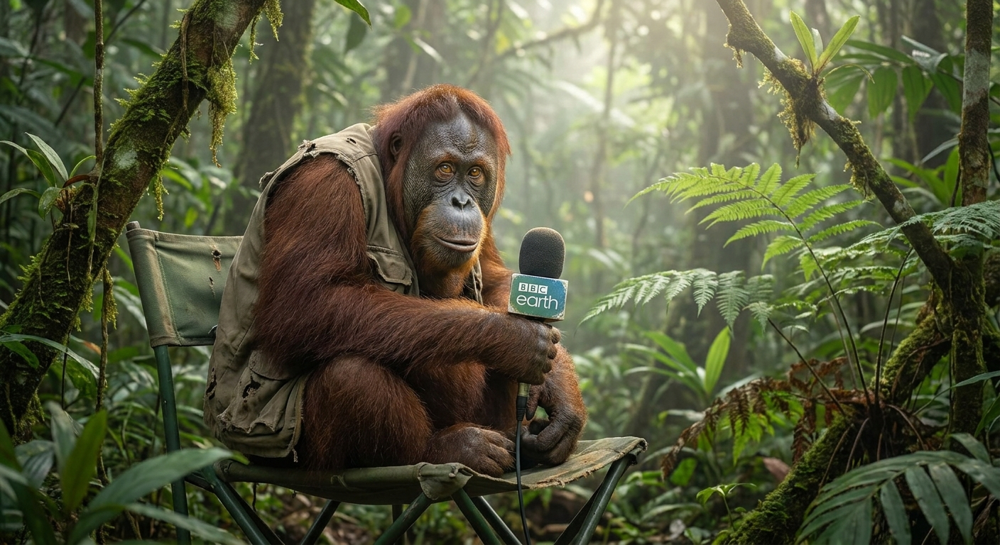

# The Telegram Documentaries

<p align="center">
  
</p>

A Telegram bot that transforms a user's portrait photo into a narrated comedy wildlife documentary. The user sends a photo, answers a few questions, and receives:

1. **A hybrid animal portrait** — the original photo fused with AI-generated animal features via the Converter stage.
2. **A dramatic one-paragraph narration** — British wildlife-documentary style, built from the behavioral dossier.
3. **A voice note** — the narration rendered to audio by Gemini TTS.

The comedy emerges from sincerity: the bot treats every subject as a majestic, rare animal observed in the wild.

---

## Pipeline Overview

| Stage | Model | What it does |
| --- | --- | --- |
| **The Bouncer** | Gemini 3.1 Flash Lite (vision) | Vision gate: confirms a human face is in the uploaded photo. Non‑human images get a cheeky in‑character rejection and a session reset. |
| **The Interviewer** | Gemini 3.1 Flash Lite | **Orchestrator**. Asks 3–4 investigative, playful, slightly eccentric questions **one at a time**, accumulates a behavioural dossier keyed to the user's `chat_id`, and suggests an animal. |
| **The Converter** | Gemini 3.1 Flash Image | Fuses the original photo with the behavioural dossier into a hybrid animal portrait, delivered directly to the Telegram chat. |
| **The Scripter** | Gemini 3.1 Flash Lite | Writes one paragraph (~60–90 words) of dramatic British wildlife narration, drawn from the dossier. |
| **The Narrator** | Gemini TTS (not an agent) | The script goes directly to text‑to‑speech and returns as a voice note — no extra conversational turn. |

**Session state** is held in memory, keyed by the user's Telegram `chat_id`. `/start` and `/restart` purge the session and any temporary media files without restarting the bot.

---

## Requirements

- Python 3.11+
- A Telegram bot token from [@BotFather](https://t.me/BotFather)
- A Google Gemini API key

---

## Setup

1. **Install dependencies:**

   ```bash
   pip install -r requirements.txt
   ```

2. **Copy the example environment file and fill in your secrets:**

   ```bash
   cp .env.example .env
   ```

   ```
   TELEGRAM_BOT_TOKEN=your_telegram_bot_token_here
   GEMINI_API_KEY=your_gemini_api_key_here
   ```

   `.env` is gitignored. Never put real keys in `.env.example`, source, or docs.

3. **Run the bot:**

   ```bash
   python -m telegram_documentaries
   ```

   It polls Telegram outbound over HTTPS, so it works behind NAT and firewalls with no ports opened.

---

## Development

Two scripts are the ground truth for this repo:

- **`scripts/test`** — runs the full check suite: `pytest`, `ruff check`, and `mypy`. Run this before you consider any change done.
- **`scripts/hooks`** — the pre-commit checks, using the same tooling and configuration.

Tests are written **before** the code (Red/Green TDD). A phase from the roadmap is complete only when its acceptance criteria are verified with these scripts green.

---

## Project Constitution

The contract this project is built against lives in `SPECS/`:

- [`SPECS/MISSION.md`](SPECS/MISSION.md) — what the product is, and what it explicitly is not.
- [`SPECS/TECH.md`](SPECS/TECH.md) — stack, architecture, and engineering policies.
- [`SPECS/ROADMAP.md`](SPECS/ROADMAP.md) — the ordered phase plan.

Feature specs live alongside them as `SPECS/<YYYY-MM-DD>-<feature-name>/`.

---

## Status

- **Phase 1** — Repository & gateway (long‑polling, bot setup) ✅
- **Phase 2** — Bouncer vision gate (human photo classification, rejection) ✅
- **Phase 3** — Interviewer (3‑4 question orchestration, dossier, animal suggestion, CONVERTING handoff) ✅

The bot long‑polls Telegram; an uploaded photo is downloaded, validated, and classified by `gemini-3.1-flash-lite` as human‑present or not. A human‑present photo starts the interview: 3–4 questions asked one at a time, each answer persisted to the session's dossier, ending in a summarised profile and a suggested animal handed to the next stage.

---

## Contact & License

- **GitHub:** [Kamal-Hussain23/The-Telegram-Documentaries](https://github.com/Kamal-Hussain23/The-Telegram-Documentaries)
- **License:** MIT (see `LICENSE` if present)

---
*Built with Python, Google ADK, and Telegram Bot API — long polling, no webhooks, no extra infrastructure.*